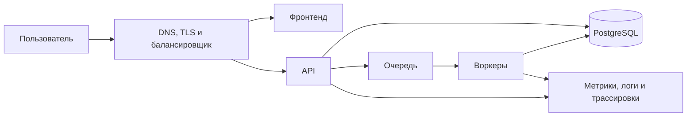

# DevOps с нуля до эксплуатации большой облачной системы

Учись на одном приложении и последовательно меняй условия его эксплуатации. Сначала подними его локально. Потом выпусти в интернет, переживи первые поломки, автоматизируй релизы и восстановление. Затем добавь нагрузку, раздели среды, перенеси приложение на управляемые сервисы и Kubernetes. В конце проведи учение по отказу целого региона.

Я заложил 36 недель по 8–12 часов. Темп можно менять: переходи дальше, когда можешь самостоятельно выполнить практическую проверку этапа. Облако в плане можно выбрать любое, где тебе доступны виртуальные машины, управляемый PostgreSQL и Kubernetes. Удобнее пройти весь маршрут у одного провайдера, чтобы видеть, как одни и те же компоненты и ограничения проявляются на разных масштабах.

Главный результат — система, которую ты умеешь развернуть с нуля, обновить под нагрузкой, диагностировать по телеметрии и восстановить после потери инфраструктуры. Масштаб отдельного стенда можно ограничить бюджетом. Сложность крупной системы отрабатывается через ограничения, отказы, требования к релизам и работу с данными.

## 1. Какое приложение взять

Подойдёт сервис бронирования билетов. Его можно сделать небольшим, а нагрузка и отказы быстро создадут задачи, характерные для боевых систем.

| Компонент | Что реализовать | Какую задачу DevOps он создаёт |
| --- | --- | --- |
| Фронтенд | Каталог мероприятий, карточка, форма бронирования | DNS, TLS, CDN, кэширование, доступность для пользователя |
| Backend API | Список мероприятий, остаток мест, создание и отмена брони | Балансировка, релизы, совместимость версий, масштабирование |
| PostgreSQL | Мероприятия, места, брони, статусы | Миграции, блокировки, резервное копирование, восстановление |
| Воркер | Обработка просроченных броней и имитация отправки подтверждения | Очереди, повторы, идемпотентность, накопление задач |
| Генератор нагрузки | Просмотр каталога, бронирование, всплеск на популярное мероприятие | Измеримая ёмкость системы и воспроизводимые эксперименты |

Если приложение уже есть, используй его. Для этого маршрута достаточно одного часто читаемого эндпоинта, одной важной операции записи и одной фоновой задачи. Если приложения ещё нет, бери знакомый язык. При полном отсутствии предпочтений подойдёт Python с FastAPI, простой фронтенд и PostgreSQL.

Сначала сделай всего три пользовательских сценария:
1. Открыть каталог.
2. Создать бронь и получить её идентификатор.
3. Узнать статус брони.

Добавь два проверяемых инварианта: последнее место нельзя забронировать дважды, а повтор одного запроса с тем же ключом идемпотентности возвращает исходный результат. Они понадобятся, когда ты начнёшь воспроизводить сетевые тайм-ауты, повторную доставку задач и отказы базы. Для тренировок используй синтетические данные.



Это схема позднего этапа. На первом стенде фронтенд, API и база живут на одной машине. Очередь, воркеры и отдельные компоненты появляются по мере выполнения плана.

## 2. Маршрут на 36 недель

### Недели 1–3. Linux, сеть и первый запрос до базы

**Неделя 1.** Подними Linux-VM. Создай обычного пользователя и настрой вход по SSH с ключом. Научись читать права файлов, видеть процессы, проверять память и место на диске. Запусти API вручную, затем как systemd-сервис. Найди его PID, сокет, логи и причину последнего перезапуска.

[Конспект недели 1: Linux, SSH и первый запуск API](docs/learning/week-01-linux.md)

**Неделя 2.** Разбери путь запроса: DNS → TCP → TLS → HTTP → reverse proxy → API → PostgreSQL. Настрой Nginx перед API. Освой curl, dig, ss, ip, journalctl, df, du и openssl s_client через конкретные поломки. Потренируйся различать ошибки разрешения имени, отказ подключения, TLS-ошибку, HTTP 502 и тайм-аут приложения.

[Конспект недели 2: сеть, Nginx и диагностика запроса](docs/learning/week-02-nginx.md)

**Неделя 3.** Заведи Git-репозиторий. Добавь миграции базы, генератор тестовых данных, переменные окружения и smoke-тест, который создаёт бронь и проверяет её статус. Напиши инструкцию для чистой машины. Удали сервис на учебной VM и восстанови его по инструкции.

**Проверка этапа.** После перезагрузки VM приложение поднимается само. Если прокси перестаёт получать ответы от API, ты можешь определить место сбоя командами, объяснить причину и восстановить доступ.

### Недели 4–6. Контейнеры и первая публичная версия

**Неделя 4.** Напиши Dockerfile для API и собери образ. Разберись, чем отличаются образ, контейнер, volume и сеть Docker. Запусти процесс под непривилегированным пользователем. Передавай конфигурацию при запуске. Проверь, что SIGTERM даёт приложению время завершить текущие запросы.

**Неделя 5.** Собери локальный стенд через Docker Compose. Добавь фронтенд, API, PostgreSQL и reverse proxy. Проверь, что база переживает пересоздание контейнера. Однократно измени версию схемы и проверь прогон миграции на пустой и уже заполненной базе.

**Неделя 6.** Разверни стенд на одной облачной VM. Настрой DNS, HTTPS, правила доступа и внешний smoke-тест. Сохрани копию базы отдельно от VM. Восстанови её в другой экземпляр PostgreSQL и проверь, что приложение читает восстановленные брони. Включи бюджетные уведомления перед созданием ресурсов. После удаления учебного стенда проверяй диски, снимки, адреса и балансировщики отдельно.

**Проверка этапа.** Приложение доступно по HTTPS. Снаружи доступны только предусмотренные точки входа. Ты можешь развернуть стенд на новой машине и восстановить данные из отдельной копии.

### Недели 7–10. CI/CD, инфраструктура как код и среды

**Неделя 7.** Настрой CI для pull request: сборка, тесты, проверка миграций, создание контейнерного образа. Публикуй образ в реестр после успешной проверки. Свяжи коммит и образ через неизменяемый идентификатор, чтобы всегда знать, какая версия запущена.

**Неделя 8.** Сделай pipeline развертывания в staging. После деплоя выполняй smoke-тест. Храни ссылку на последнюю рабочую версию и отработай откат. Сделай учебный релиз, который успешно стартует, но ломает создание брони. Проверь, обнаруживает ли его проверка после деплоя.

**Неделя 9.** Опиши сеть, VM, правила доступа, DNS и хранилище резервных копий в Terraform или OpenTofu. Разберись с plan, apply, состоянием и импортом. Настрой удалённое хранение состояния с контролем доступа и блокировкой, если её поддерживает выбранный backend. Создай учебный стенд из кода, внеси ручное изменение и проверь, видит ли его следующий план.

**Неделя 10.** Раздели dev, staging и prod по конфигурации, данным, правам и состоянию IaC. Продвигай один и тот же образ из staging в prod. Проведи релиз с миграцией по схеме expand/contract: добавь совместимое поле, выпусти код, перенеси данные и удали старое поле отдельным релизом после проверки. Отработай откат приложения после добавления поля.

**Проверка этапа.** По коммиту можно найти образ и релиз. Новая среда создаётся по коду. Ты можешь восстановить предыдущую версию приложения и знаешь, с какими версиями схемы она совместима.

### Недели 11–14. Наблюдаемость и нагрузка

**Неделя 11.** Добавь структурированные логи и идентификатор запроса. Измеряй число запросов, ошибки и задержку по маршрутам. Для базы собери число соединений и сведения о медленных запросах. Сделай дашборд с RPS, долей ошибок, p50/p95/p99 и насыщением ресурсов.

**Неделя 12.** Добавь распределённую трассировку через OpenTelemetry для пути API → база и для фоновой операции, когда она появится. Введи два SLI: долю успешных бронирований и задержку бронирования. Задай учебные SLO, например 99,9% успешных валидных запросов за 30 дней и p95 до 300 мс при целевой нагрузке. Отдельно определи ожидаемый ответ на отсутствие мест и признаки серверной ошибки. Настрой внешнюю синтетическую проверку.

**Неделя 13.** Напиши сценарии нагрузки в k6 или аналогичном инструменте. Проведи ступенчатый тест, короткий всплеск и длительный тест. Раздели обычный трафик по каталогу и конкуренцию за последние места одного мероприятия. Фиксируй поступивший и обработанный RPS, ошибки, задержку и состояние зависимостей. Запускай нагрузку на собственный учебный стенд.

**Неделя 14.** Найди первое узкое место. Для каждого эксперимента запиши гипотезу, измени один параметр и повтори тот же тест. Например, сравни запрос до и после добавления индекса, сохрани план выполнения и проверь влияние изменения на запись. Заведи алерты на деградацию пользовательских сценариев и добавь к ним краткие инструкции диагностики.

**Проверка этапа.** У тебя есть воспроизводимый отчёт о пропускной способности. Ты можешь назвать режим нагрузки, при котором нарушается SLO, показать свидетельство причины и измерить эффект исправления.

### Недели 15–18. Высокая доступность, база и асинхронная обработка

**Неделя 15.** Подними минимум два экземпляра API за балансировщиком. Настрой health checks и корректный вывод экземпляра из обслуживания. Удали один экземпляр во время нагрузки. Измерь ошибки, время обнаружения и поведение оставшейся реплики. Повтори эксперимент в разных зонах доступности, если они доступны в выбранном регионе.

**Неделя 16.** Перенеси PostgreSQL в управляемый сервис. Рассчитай бюджет подключений: число реплик × максимальный размер пула, плюс воркеры, миграции и административные подключения. Проверь фактическое число соединений при всплеске нагрузки. Отработай восстановление на момент времени в отдельный экземпляр. Проверь данные через приложение.

**Неделя 17.** Добавь одну очередь и отдельный воркер. Настрой время ожидания, конечное число повторов и очередь для задач, исчерпавших повторы. Останови воркер в середине работы и проверь обработку повторной доставки. Измеряй возраст старейшей задачи и скорость обработки очереди.

**Неделя 18.** Вынеси статические файлы в объектное хранилище с CDN, если это соответствует архитектуре фронтенда. Для API добавь тайм-ауты и ограничение конкурентной работы. Сравни поведение во время всплеска: как система принимает нагрузку, как отказывает и как быстро возвращается к штатным показателям. Если возникла необходимость записывать бронь и публиковать событие как одну логическую операцию, реализуй transactional outbox и проверь сбой между этими действиями.

**Проверка этапа.** Ты наблюдал потерю экземпляра, временную недоступность базы и накопление очереди. После повторной доставки задания критический эффект происходит один раз. У тебя есть измеренное время восстановления данных.

### Недели 19–23. Kubernetes и GitOps

**Неделя 19.** Начни с локального кластера. Перенеси API и воркер в Deployment. Настрой Service, маршрутизацию HTTP и конфигурацию приложения. Разберись в requests, limits, startup, readiness и liveness probes. Воспроизведи ошибки конфигурации и нехватку ресурсов. Диагностируй по событиям и логам.

**Неделя 20.** Перенеси нагрузки в управляемый Kubernetes. Подключи реестр образов и внешний PostgreSQL. Настрой права приложения через идентичность нагрузки и раздели роли деплоя, чтения и администрирования. Проверь сетевые политики в кластере, который их применяет.

**Неделя 21.** Настрой rolling update, распределение реплик между узлами и зонами, а также PodDisruptionBudget для добровольных вытеснений. Удали pod во время теста, затем проведи контролируемый drain узла. Измерь эффект для клиентов и проверь, хватает ли ресурсов для размещения реплик при потере узла.

**Неделя 22.** Настрой горизонтальное масштабирование. Для API начни с CPU или метрики запросов, для воркера попробуй метрику очереди. Измерь время от начала всплеска до готовности новых реплик. Повтори тест с масштабированием пула узлов. Посмотри, как рост реплик влияет на соединения с базой и скорость обработки задач.

**Неделя 23.** Выбери Helm или Kustomize для упаковки конфигурации и Argo CD или Flux для GitOps. Проведи релиз изменением версии образа в Git. Сделай ручное изменение в кластере и посмотри, как обнаруживается расхождение. Отработай возврат версии через Git. Запиши процедуру аварийного изменения и последующего приведения Git и кластера к одному состоянию.

**Проверка этапа.** Ты можешь объяснить, почему pod не запустился, почему он запустился без готовности принимать трафик и почему здоровые реплики всё равно могут дать плохую задержку. Релиз, откат и потеря узла проверены под нагрузкой.

### Недели 24–27. Безопасность эксплуатации и управляемые релизы

**Неделя 24.** Составь карту доступов: разработчик, CI, API, воркер, оператор, резервное копирование. Выдай каждому субъекту необходимые права. Настрой короткоживущую идентичность CI там, где это поддерживается. Проведи ротацию секрета базы и проверь поведение действующих подключений.

**Неделя 25.** Добавь сканирование образов и зависимостей, проверку конфигурации IaC и учёт состава сборки. Проверь, что образ связан с исходным коммитом, прод получает артефакт, уже проверенный в staging, а операции развертывания журналируются.

**Неделя 26.** Введи прогрессивный релиз. Направь учебные 5% трафика на новую версию, сравни её ошибки и задержку со старой и увеличь долю после проверки. Сделай версию с деградацией только на операции бронирования. Проверь реакцию релиза по метрике самого сценария.

**Неделя 27.** Проведи тренировку дежурства. Подготовь сценарии для роста 5xx, переполнения пула соединений, отставания очереди и плохого релиза. Для каждого отработай обнаружение, оценку влияния, восстановление и разбор. Запиши хронологию и конкретные действия, которые уменьшают вероятность повторения или время восстановления.

**Проверка этапа.** Ты можешь показать, кто выпустил версию, какие действия ей доступны, как ротируется её секрет и какие показатели останавливают дальнейшее продвижение релиза.

### Недели 28–31. Масштаб, ёмкость и стоимость

**Неделя 28.** Сделай модель нагрузки. Укажи средний и пиковый RPS, доли чтения и записи, размер ответов, число фоновых задач и рост данных. Используй свои измерения, чтобы оценить число реплик, объём исходящего трафика и допустимое число соединений. Повтори расчёт для трёх сценариев, например 100, 1 000 и 10 000 RPS. Для расчётных значений явно укажи предпосылки.

**Неделя 29.** Исследуй кэширование каталога. Измерь нагрузку на базу и задержку при холодном и прогретом кэше. Проверь одновременное истечение TTL у популярных записей. Отдельно измерь, как распределение нагрузки меняется, когда множество пользователей одновременно бронируют последнее место.

**Неделя 30.** Поработай с большим набором синтетических данных. Измерь запросы и блокировки при чтении и записи. Попробуй реплику для чтения, если тест показывает соответствующее узкое место. Создай ситуацию с отставанием реплики и проверь, что пользователь видит сразу после записи. При наличии задачи на хранение истории сравни партиционирование или архивирование с текущей схемой.

**Неделя 31.** Проведи ступенчатый тест после изменений. Сопоставь стоимость обслуженного миллиона запросов, стоимость простоя и стоимость хранения данных. Построй таблицу для обычной нагрузки, пика и потери части мощности. Укажи, сколько времени займёт наращивание ресурсов, какие квоты нужно учитывать и какая зависимость ограничивает рост первой.

Пример расчёта ёмкости: если одна реплика устойчиво выполняет 120 RPS в пределах SLO, то для пика 600 RPS после потери одной из трёх зон потребуется не менее пяти оставшихся реплик. При равномерном распределении по три реплики в каждой зоне после потери зоны останется шесть, то есть расчётно 720 RPS. Это оценка мощности API. Её нужно проверить общим тестом, потому что реплики конкурируют за одну базу и другие зависимости.

**Проверка этапа.** Ты можешь обосновать, какую мощность заложить, сколько стоит дополнительный запас и при каком изменении профиля трафика расчёт перестанет выполняться.

### Недели 32–36. Восстановление после аварии и итоговая эксплуатация

**Неделя 32.** Определи RTO и RPO для бронирований. RTO — допустимое время до восстановления операции. RPO — допустимый объём потери последних данных, выраженный во времени. Для учебной цели можно взять RTO 30 минут и RPO 5 минут. Запиши, с какого события начинается отсчёт и какие клиентские операции означают восстановление.

**Неделя 33.** Подготовь восстановление в другом регионе. Подними сеть, приложение и доступы из IaC. Проверь доступность копий данных, контейнерных образов, конфигурации и ключей, необходимых для восстановления. Подготовь порядок переключения трафика и проверь, что у приложения в любой момент один активный источник записи.

**Неделя 34.** Проведи учение. Создавай брони с известными идентификаторами до события и во время него. Сделай основной учебный регион недоступным для выбранных клиентов и восстанови сервис во втором. Измерь время до успешной новой брони и проверь прежние подтверждённые брони. Запиши фактические RTO и RPO. Отработай возврат трафика с учётом записей, сделанных во втором регионе.

**Неделя 35.** Собери эксплуатационный комплект: схемы, карту зависимостей, инструкции по релизу и откату, SLO, журнал инцидентов, бюджет, отчёт о нагрузке и runbook восстановления. Пройди по инструкциям с чистого окружения. Исправь шаги, которые зависят от настроек, оставшихся от прошлых экспериментов.

**Неделя 36.** Проведи итоговую демонстрацию. Подними пустую среду, выпусти приложение, создай нагрузку, разверни версию с деградацией, восстанови нормальную работу, затем восстанови данные в другой среде. По результатам зафиксируй, какие цели достигнуты, где остался ручной шаг и какое ограничение проявится при следующем увеличении нагрузки.

## 3. Как работать над каждым этапом

Держи весь учебный проект в одном репозитории, пока у разделения нет конкретной эксплуатационной причины.

```text
infra-lab/
  app/
    frontend/
    api/
    worker/
  infra/
  deploy/
  load/
  docs/
    architecture/
    decisions/
    runbooks/
    incidents/
    experiments/
```

На одну неделю планируй одну работающую возможность и один эксперимент. Например, «провести релиз без остановки API» и «измерить, что произойдёт при завершении реплики в середине запроса». Для эксперимента записывай:

1. Версию приложения, состав стенда и параметры нагрузки.
2. Ожидаемое поведение и способ его проверить.
3. Одно изменение или отключение компонента.
4. Наблюдения со стороны клиента и по телеметрии.
5. Исправление и результат повторного запуска в тех же условиях.

Для практики по инцидентам веди таблицу с условиями, наблюдениями и критериями восстановления.

| Учение | Что измерить |
| --- | --- |
| Остановить один API-процесс | Время удаления из балансировки, число ошибок, задержка у оставшихся реплик |
| Исчерпать пул подключений | Время ожидания соединения, глубину очереди запросов, время нормализации |
| Остановить воркеры на 10 минут | Возраст старейшей задачи, время разбора накопленного объёма, число повторов |
| Выпустить медленную версию API | Время обнаружения по SLI и время до восстановления после отката |
| Восстановить базу в отдельный экземпляр | Время до первой успешной брони, последнюю восстановленную запись, целостность остатков |
| Переключиться на другой регион | Время восстановления чтения и записи, судьбу подтверждённых броней, корректность возврата трафика |

## 4. Первая неделя по занятиям

Если начинаешь сегодня, цель недели — HTTP-ответ из Linux-VM и самостоятельная диагностика двух поломок.

| Занятие | Что сделать | Признак готовности |
| --- | --- | --- |
| 1. Linux и SSH | Поднять VM, создать пользователя, настроить ключ, открыть два SSH-сеанса | Вход воспроизводится, ты знаешь, с какими правами работаешь |
| 2. Процессы и порты | Запустить минимальный HTTP-сервис с /health, найти PID и порт | curl возвращает ответ, ss показывает, где процесс слушает |
| 3. systemd | Написать unit, запустить сервис, посмотреть логи, перезагрузить VM | Сервис поднимается автоматически, его логи доступны через journalctl |
| 4. Reverse proxy | Поставить Nginx и направить запрос к API через него | Ты можешь проверить отдельно клиентский запрос к прокси и запрос прокси к API |
| 5. Поломки | Остановить backend, затем восстановить его и отдельно указать неверный upstream-порт | Для каждой поломки ты записал симптом, команду диагностики, причину и исправление |
| 6. Воспроизводимость | Описать установку в README и пройти её на чистой VM | Другой человек может повторить шаги и получить тот же ответ от /health |

Первый коммит может содержать небольшой HTTP-сервис, его systemd unit, конфигурацию Nginx и README. В конце недели сохрани вывод трёх проверок: прямой запрос к API, запрос через прокси и запрос после перезагрузки машины. Это исходная точка, к которой ты будешь добавлять базу, релизы, метрики и отказоустойчивость.
