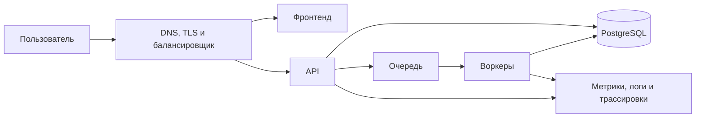

# DevOps с нуля до эксплуатации большой облачной системы

Учись на одном приложении и последовательно меняй условия его эксплуатации. Сначала подними его локально. Потом выпусти в интернет, переживи первые поломки, автоматизируй релизы и восстановление. Затем добавь нагрузку, раздели среды, перенеси приложение на управляемые сервисы и Kubernetes. В конце проведи учение по отказу целого региона.

Базовый маршрут разбит на 36 учебных недель. Продвинутый трек AWS выполняй по критериям приёмки в удобном темпе. Темп можно менять: переходи дальше, когда можешь самостоятельно выполнить практическую проверку этапа. Облачные этапы проходи на AWS.

Главный результат — система, которую ты умеешь развернуть с нуля, обновить под нагрузкой, диагностировать по телеметрии и восстановить после потери инфраструктуры. Масштаб отдельного стенда можно ограничить бюджетом. Сложность крупной системы отрабатывается через ограничения, отказы, требования к релизам и работу с данными.

**Как проходить курс.** Начни с недель 1–36. Затем выполни продвинутые лабораторные AWS (§5–6) и модули Senior DevOps, SRE и Platform Engineering (§7–8). Модули из §7 можно проходить параллельно со связанными лабораторными AWS. Для каждой темы сохраняй артефакт и измеримый результат.

## Целевая архитектура учебного проекта

На VM ты изучишь Linux и автоматизацию хостов, затем перенесёшь приложение в Kubernetes и выстроишь процесс выпуска для нескольких сред. Все стенды работают с синтетическими данными.

| Стенд | Где живёт | Как выпускается |
|---|---|---|
| Local | Docker Compose, затем kind для практики Kubernetes | Локальная сборка и тесты |
| Dev | Namespace в non-prod кластере, своя база и секреты | Автосинхронизация Argo CD после слияния PR с новой версией |
| Staging | Отдельный namespace того же кластера, своя база и конфигурация, схожая с prod | Продвижение проверенного digest образа через PR, миграции, smoke-тест и нагрузочные проверки |
| Prod | Отдельный кластер и облачный аккаунт или проект, собственные сеть, IAM, база и Terraform state | PR с проверкой, затем постепенный выпуск с Argo Rollouts и контролем SLI |
| DR | Временный стенд во втором регионе | Развёртывание из Terraform и GitOps, восстановление данных и учебное переключение |

У dev и staging общая точка отказа на уровне кластера. Раздели квоты, права, сетевой доступ и данные этих сред. Для итогового учения проверь, что учётная запись CI для non-prod не может менять prod. Дорогие кластеры и DR-ресурсы можно поднимать на время практики.

| Слой | Основной инструмент и его задача |
|---|---|
| Облачная инфраструктура | Terraform создаёт сеть, IAM, кластер, реестр, хранилища и управляемую БД. Для каждой среды свой state и доступ к нему. |
| Настройка Linux | Ansible настраивает VM через роли: пользователи, пакеты, Nginx, systemd и агенты наблюдаемости. Используй его на первом стенде, затем для выделенного нагрузочного генератора. |
| Сборка и проверка | GitHub Actions запускает тесты, собирает образ, сканирует его Trivy и публикует в реестр. CI открывает PR в GitOps с digest образа. |
| Доставка | Helm описывает приложение. Argo CD применяет конфигурацию из Git. AppProject ограничивает разрешённые репозитории и назначения. ApplicationSet создаёт приложения для нескольких сред после того, как ты освоишь обычный Application. |
| Секреты | Облачный менеджер секретов, идентичность нагрузки и External Secrets Operator. Проверь ротацию секрета и обновление приложения. |
| Наблюдаемость | Prometheus и Grafana для метрик и алертов, Loki для логов, OpenTelemetry Collector и Tempo для трассировок. |
| Нагрузка и релизы | k6 воспроизводит профиль трафика. Argo Rollouts ведёт canary-релиз и проверяет метрику успешности бронирований. |

В учебном проекте можно завести три репозитория: приложение с CI, облачная инфраструктура с Terraform и Ansible, конфигурация кластеров с Helm и Argo CD. Защити ветки инфраструктуры и prod-конфигурации. Для одного релиза сохрани цепочку от коммита приложения до digest, PR продвижения, синхронизации Argo CD и метрик после выкладки. Для практики нескольких команд введи владельцев каталогов через CODEOWNERS и роли ревьюера и оператора дежурства.

На итоговом экзамене создай среду из пустого облачного проекта, продвинь один образ через три стенда и покажи, что ручное изменение в dev обнаруживается Argo CD. Затем выпусти в учебный prod версию с деградацией бронирований, останови продвижение canary по метрике, верни предыдущий digest в Git и проверь восстановление. Заверши упражнение восстановлением базы и приложения во втором регионе с замером RTO и RPO.

Документация для практики — [Terraform](https://developer.hashicorp.com/terraform/docs), [Ansible](https://docs.ansible.com/), [Argo CD ApplicationSet](https://argo-cd.readthedocs.io/en/stable/operator-manual/applicationset/) и [Argo Rollouts](https://argo-rollouts.readthedocs.io/en/stable/).

## 1. Какое приложение взять

Подойдёт сервис бронирования билетов. Его можно сделать небольшим, а нагрузка и отказы быстро создадут задачи, характерные для боевых систем.

| Компонент | Что реализовать | Какую задачу DevOps он создаёт |
| --- | --- | --- |
| Фронтенд | Каталог мероприятий, карточка, форма бронирования | DNS, TLS, CDN, кэширование, доступность для пользователя |
| Backend API | Список мероприятий, остаток мест, создание и отмена брони | Балансировка, релизы, совместимость версий, масштабирование |
| PostgreSQL | Мероприятия, места, брони, статусы | Миграции, блокировки, резервное копирование, восстановление |
| Воркер | Обработка просроченных броней и имитация отправки подтверждения | Очереди, повторы, идемпотентность, накопление задач |
| Генератор нагрузки | Просмотр каталога, бронирование, всплеск на популярное мероприятие | Измеримая ёмкость системы и воспроизводимые эксперименты |

Если приложение уже есть, используй его. Для этого маршрута достаточно одного часто читаемого эндпоинта, одной важной операции записи и одной фоновой задачи. Если приложения ещё нет, бери знакомый язык. При полном отсутствии предпочтений подойдёт Python с FastAPI, простой фронтенд и PostgreSQL.

Сначала сделай всего три пользовательских сценария:
1. Открыть каталог.
2. Создать бронь и получить её идентификатор.
3. Узнать статус брони.

Добавь два проверяемых инварианта: последнее место нельзя забронировать дважды, а повтор одного запроса с тем же ключом идемпотентности возвращает исходный результат. Они понадобятся, когда ты начнёшь воспроизводить сетевые тайм-ауты, повторную доставку задач и отказы базы. Для тренировок используй синтетические данные.



Это схема позднего этапа. На первом стенде фронтенд, API и база живут на одной машине. Очередь, воркеры и отдельные компоненты появляются по мере выполнения плана.

## 2. Маршрут на 36 недель

### Недели 1–3. Linux, сеть и первый запрос до базы

Перед лабораторной пройди [вопросы и задания к текущему этапу](#теория-и-практика-по-ходу-проекта).

**Неделя 1.** Подними Linux-VM. Создай обычного пользователя и настрой вход по SSH с ключом. Научись читать права файлов, видеть процессы, проверять память и место на диске. Запусти API вручную, затем как systemd-сервис. Найди его PID, сокет, логи и причину последнего перезапуска.

[Конспект недели 1: Linux, SSH и первый запуск API](docs/learning/week-01-linux.md)

**Неделя 2.** Разбери путь запроса: DNS → TCP → TLS → HTTP → reverse proxy → API → PostgreSQL. Настрой Nginx перед API. Освой curl, dig, ss, ip, journalctl, df, du и openssl s_client через конкретные поломки. Потренируйся различать ошибки разрешения имени, отказ подключения, TLS-ошибку, HTTP 502 и тайм-аут приложения.

[Конспект недели 2: сеть, Nginx и диагностика запроса](docs/learning/week-02-nginx.md)

**Неделя 3.** Заведи Git-репозиторий. Добавь миграции базы, генератор тестовых данных, переменные окружения и smoke-тест, который создаёт бронь и проверяет её статус. Напиши инструкцию для чистой машины. Удали сервис на учебной VM и восстанови его по инструкции.

[Инструкция по развёртыванию и восстановлению на VM](docs/runbooks/amazon-linux-vm.md)

[Конспект недели 3: Git, smoke-тест и восстановление API](docs/learning/week-03-recovery.md)

**Проверка этапа.** После перезагрузки VM приложение поднимается само. Если прокси перестаёт получать ответы от API, ты можешь определить место сбоя командами, объяснить причину и восстановить доступ.

### Недели 4–6. Контейнеры и первая публичная версия

Перед лабораторной пройди [вопросы и задания к текущему этапу](#теория-и-практика-по-ходу-проекта).

**Неделя 4.** Напиши Dockerfile для API и собери образ. Разберись, чем отличаются образ, контейнер, volume и сеть Docker. Запусти процесс под непривилегированным пользователем. Передавай конфигурацию при запуске. Проверь, что SIGTERM даёт приложению время завершить текущие запросы.

[Конспект недели 4: Образ и контейнер API](docs/learning/week-04-docker.md)

**Неделя 5.** Собери локальный стенд через Docker Compose. Добавь фронтенд, API, PostgreSQL и reverse proxy. Проверь, что база переживает пересоздание контейнера. Однократно измени версию схемы и проверь прогон миграции на пустой и уже заполненной базе.

**Неделя 6.** Разверни стенд на одной облачной VM. Перенеси ручную настройку хоста в Ansible. Сделай inventory и роли для пользователей, Nginx и приложения. Настрой handler для перезапуска при изменении конфигурации. Повтори playbook и проверь отсутствие изменений, затем подготовь им чистую VM. Настрой DNS, HTTPS, правила доступа и внешний smoke-тест. Сохрани копию базы отдельно от VM. Восстанови её в другой экземпляр PostgreSQL и проверь, что приложение читает восстановленные брони. Включи бюджетные уведомления перед созданием ресурсов. После удаления учебного стенда проверяй диски, снимки, адреса и балансировщики отдельно.

**Проверка этапа.** Приложение доступно по HTTPS. Снаружи доступны только предусмотренные точки входа. Ты можешь развернуть стенд на новой машине и восстановить данные из отдельной копии.

### Недели 7–10. CI/CD, инфраструктура как код и среды

Перед лабораторной пройди [вопросы и задания к текущему этапу](#теория-и-практика-по-ходу-проекта).

**Неделя 7.** Настрой CI для pull request: сборка, тесты, проверка миграций, создание контейнерного образа. Публикуй образ в реестр после успешной проверки. Свяжи коммит и образ через неизменяемый идентификатор, чтобы всегда знать, какая версия запущена.

**Неделя 8.** Сделай pipeline развертывания в staging. После деплоя выполняй smoke-тест. Храни ссылку на последнюю рабочую версию и отработай откат. Сделай учебный релиз, который успешно стартует, но ломает создание брони. Проверь, обнаруживает ли его проверка после деплоя.

**Неделя 9.** Опиши сеть, VM, правила доступа, DNS и хранилище резервных копий в Terraform. Подключи inventory Ansible по облачным тегам среды или сгенерируй его из outputs Terraform. Разберись с plan, apply, состоянием и импортом. Настрой удалённое хранение состояния с контролем доступа и блокировкой, если её поддерживает выбранный backend. Создай учебный стенд из кода, внеси ручное изменение и проверь, видит ли его следующий план.

**Неделя 10.** Раздели dev, staging и prod по конфигурации, данным, правам и состоянию IaC. Продвигай один и тот же образ из staging в prod. Проведи релиз с миграцией по схеме expand/contract: добавь совместимое поле, выпусти код, перенеси данные и удали старое поле отдельным релизом после проверки. Отработай откат приложения после добавления поля.

**Проверка этапа.** По коммиту можно найти образ и релиз. Новая среда создаётся по коду. Ты можешь восстановить предыдущую версию приложения и знаешь, с какими версиями схемы она совместима.

### Недели 11–14. Наблюдаемость и нагрузка

Перед лабораторной пройди [вопросы и задания к текущему этапу](#теория-и-практика-по-ходу-проекта).

**Неделя 11.** Добавь структурированные логи и идентификатор запроса. Измеряй число запросов, ошибки и задержку по маршрутам. Для базы собери число соединений и сведения о медленных запросах. Сделай дашборд с RPS, долей ошибок, p50/p95/p99 и насыщением ресурсов.

**Неделя 12.** Добавь распределённую трассировку через OpenTelemetry для пути API → база и для фоновой операции, когда она появится. Введи два SLI: долю успешных бронирований и задержку бронирования. Задай учебные SLO, например 99,9% успешных валидных запросов за 30 дней и p95 до 300 мс при целевой нагрузке. Отдельно определи ожидаемый ответ на отсутствие мест и признаки серверной ошибки. Настрой внешнюю синтетическую проверку.

**Неделя 13.** Напиши сценарии нагрузки в k6 или аналогичном инструменте. Проведи ступенчатый тест, короткий всплеск и длительный тест. Раздели обычный трафик по каталогу и конкуренцию за последние места одного мероприятия. Фиксируй поступивший и обработанный RPS, ошибки, задержку и состояние зависимостей. Запускай нагрузку на собственный учебный стенд.

**Неделя 14.** Найди первое узкое место. Для каждого эксперимента запиши гипотезу, измени один параметр и повтори тот же тест. Например, сравни запрос до и после добавления индекса, сохрани план выполнения и проверь влияние изменения на запись. Заведи алерты на деградацию пользовательских сценариев и добавь к ним краткие инструкции диагностики.

**Проверка этапа.** У тебя есть воспроизводимый отчёт о пропускной способности. Ты можешь назвать режим нагрузки, при котором нарушается SLO, показать свидетельство причины и измерить эффект исправления.

### Недели 15–18. Высокая доступность, база и асинхронная обработка

Перед лабораторной пройди [вопросы и задания к текущему этапу](#теория-и-практика-по-ходу-проекта).

**Неделя 15.** Подними минимум два экземпляра API за балансировщиком. Настрой health checks и корректный вывод экземпляра из обслуживания. Удали один экземпляр во время нагрузки. Измерь ошибки, время обнаружения и поведение оставшейся реплики. Повтори эксперимент в разных зонах доступности, если они доступны в выбранном регионе.

**Неделя 16.** Перенеси PostgreSQL в управляемый сервис. Рассчитай бюджет подключений: число реплик × максимальный размер пула, плюс воркеры, миграции и административные подключения. Проверь фактическое число соединений при всплеске нагрузки. Отработай восстановление на момент времени в отдельный экземпляр. Проверь данные через приложение.

**Неделя 17.** Добавь одну очередь и отдельный воркер. Настрой время ожидания, конечное число повторов и очередь для задач, исчерпавших повторы. Останови воркер в середине работы и проверь обработку повторной доставки. Измеряй возраст старейшей задачи и скорость обработки очереди.

**Неделя 18.** Вынеси статические файлы в объектное хранилище с CDN, если это соответствует архитектуре фронтенда. Для API добавь тайм-ауты и ограничение конкурентной работы. Сравни поведение во время всплеска: как система принимает нагрузку, как отказывает и как быстро возвращается к штатным показателям. Если возникла необходимость записывать бронь и публиковать событие как одну логическую операцию, реализуй transactional outbox и проверь сбой между этими действиями.

**Проверка этапа.** Ты наблюдал потерю экземпляра, временную недоступность базы и накопление очереди. После повторной доставки задания критический эффект происходит один раз. У тебя есть измеренное время восстановления данных.

### Недели 19–23. Kubernetes и GitOps

Перед лабораторной пройди [вопросы и задания к текущему этапу](#теория-и-практика-по-ходу-проекта).

**Неделя 19.** Начни с локального кластера. Перенеси API и воркер в Deployment. Настрой Service, маршрутизацию HTTP и конфигурацию приложения. Разберись в requests, limits, startup, readiness и liveness probes. Воспроизведи ошибки конфигурации и нехватку ресурсов. Диагностируй по событиям и логам.

**Неделя 20.** Перенеси нагрузки в управляемый Kubernetes. Подключи реестр образов и внешний PostgreSQL. Настрой права приложения через идентичность нагрузки и раздели роли деплоя, чтения и администрирования. Проверь сетевые политики в кластере, который их применяет.

**Неделя 21.** Настрой rolling update, распределение реплик между узлами и зонами, а также PodDisruptionBudget для добровольных вытеснений. Удали pod во время теста, затем проведи контролируемый drain узла. Измерь эффект для клиентов и проверь, хватает ли ресурсов для размещения реплик при потере узла.

**Неделя 22.** Настрой горизонтальное масштабирование. Для API начни с CPU или метрики запросов, для воркера попробуй метрику очереди. Измерь время от начала всплеска до готовности новых реплик. Повтори тест с масштабированием пула узлов. Посмотри, как рост реплик влияет на соединения с базой и скорость обработки задач.

**Неделя 23.** Упакуй приложение в Helm и подключи Argo CD. Создай AppProject с разрешёнными назначениями, затем разверни dev, staging и prod через ApplicationSet с отдельными values и версиями образов. Проведи релиз изменением версии образа в Git. Сделай ручное изменение в кластере и посмотри, как обнаруживается расхождение. Отработай возврат версии через Git. Запиши процедуру аварийного изменения и последующего приведения Git и кластера к одному состоянию.

**Проверка этапа.** Ты можешь объяснить, почему pod не запустился, почему он запустился без готовности принимать трафик и почему здоровые реплики всё равно могут дать плохую задержку. Релиз, откат и потеря узла проверены под нагрузкой.

### Недели 24–27. Безопасность эксплуатации и управляемые релизы

Перед лабораторной пройди [вопросы и задания к текущему этапу](#теория-и-практика-по-ходу-проекта).

**Неделя 24.** Составь карту доступов: разработчик, CI, API, воркер, оператор, резервное копирование. Выдай каждому субъекту необходимые права. Настрой короткоживущую идентичность CI там, где это поддерживается. Проведи ротацию секрета базы и проверь поведение действующих подключений.

**Неделя 25.** Добавь сканирование образов и зависимостей, проверку конфигурации IaC и учёт состава сборки. Проверь, что образ связан с исходным коммитом, прод получает артефакт, уже проверенный в staging, а операции развертывания журналируются.

**Неделя 26.** Введи прогрессивный релиз через Argo Rollouts и AnalysisTemplate с метрикой Prometheus. Направь учебные 5% трафика на новую версию, сравни её ошибки и задержку со старой и увеличь долю после проверки. Сделай версию с деградацией только на операции бронирования. Проверь реакцию релиза по метрике самого сценария.

**Неделя 27.** Проведи тренировку дежурства. Подготовь сценарии для роста 5xx, переполнения пула соединений, отставания очереди и плохого релиза. Для каждого отработай обнаружение, оценку влияния, восстановление и разбор. Запиши хронологию и конкретные действия, которые уменьшают вероятность повторения или время восстановления.

**Проверка этапа.** Ты можешь показать, кто выпустил версию, какие действия ей доступны, как ротируется её секрет и какие показатели останавливают дальнейшее продвижение релиза.

### Недели 28–31. Масштаб, ёмкость и стоимость

Перед лабораторной пройди [вопросы и задания к текущему этапу](#теория-и-практика-по-ходу-проекта).

**Неделя 28.** Сделай модель нагрузки. Укажи средний и пиковый RPS, доли чтения и записи, размер ответов, число фоновых задач и рост данных. Используй свои измерения, чтобы оценить число реплик, объём исходящего трафика и допустимое число соединений. Повтори расчёт для трёх сценариев, например 100, 1 000 и 10 000 RPS. Для расчётных значений явно укажи предпосылки.

**Неделя 29.** Исследуй кэширование каталога. Измерь нагрузку на базу и задержку при холодном и прогретом кэше. Проверь одновременное истечение TTL у популярных записей. Отдельно измерь, как распределение нагрузки меняется, когда множество пользователей одновременно бронируют последнее место.

**Неделя 30.** Поработай с большим набором синтетических данных. Измерь запросы и блокировки при чтении и записи. Попробуй реплику для чтения, если тест показывает соответствующее узкое место. Создай ситуацию с отставанием реплики и проверь, что пользователь видит сразу после записи. При наличии задачи на хранение истории сравни партиционирование или архивирование с текущей схемой.

**Неделя 31.** Проведи ступенчатый тест после изменений. Сопоставь стоимость обслуженного миллиона запросов, стоимость простоя и стоимость хранения данных. Построй таблицу для обычной нагрузки, пика и потери части мощности. Укажи, сколько времени займёт наращивание ресурсов, какие квоты нужно учитывать и какая зависимость ограничивает рост первой.

Пример расчёта ёмкости: если одна реплика устойчиво выполняет 120 RPS в пределах SLO, то для пика 600 RPS после потери одной из трёх зон потребуется не менее пяти оставшихся реплик. При равномерном распределении по три реплики в каждой зоне после потери зоны останется шесть, то есть расчётно 720 RPS. Это оценка мощности API. Её нужно проверить общим тестом, потому что реплики конкурируют за одну базу и другие зависимости.

**Проверка этапа.** Ты можешь обосновать, какую мощность заложить, сколько стоит дополнительный запас и при каком изменении профиля трафика расчёт перестанет выполняться.

### Недели 32–36. Восстановление после аварии и итоговая эксплуатация

Перед лабораторной пройди [вопросы и задания к текущему этапу](#теория-и-практика-по-ходу-проекта).

**Неделя 32.** Определи RTO и RPO для бронирований. RTO — допустимое время до восстановления операции. RPO — допустимый объём потери последних данных, выраженный во времени. Для учебной цели можно взять RTO 30 минут и RPO 5 минут. Запиши, с какого события начинается отсчёт и какие клиентские операции означают восстановление.

**Неделя 33.** Подготовь восстановление в другом регионе. Подними сеть, приложение и доступы из IaC. Проверь доступность копий данных, контейнерных образов, конфигурации и ключей, необходимых для восстановления. Подготовь порядок переключения трафика и проверь, что у приложения в любой момент один активный источник записи.

**Неделя 34.** Проведи учение. Создавай брони с известными идентификаторами до события и во время него. Сделай основной учебный регион недоступным для выбранных клиентов и восстанови сервис во втором. Измерь время до успешной новой брони и проверь прежние подтверждённые брони. Запиши фактические RTO и RPO. Отработай возврат трафика с учётом записей, сделанных во втором регионе.

**Неделя 35.** Собери эксплуатационный комплект: схемы, карту зависимостей, инструкции по релизу и откату, SLO, журнал инцидентов, бюджет, отчёт о нагрузке и runbook восстановления. Пройди по инструкциям с чистого окружения. Исправь шаги, которые зависят от настроек, оставшихся от прошлых экспериментов.

**Неделя 36.** Проведи итоговую демонстрацию. Подними пустую среду, выпусти приложение, создай нагрузку, разверни версию с деградацией, восстанови нормальную работу, затем восстанови данные в другой среде. По результатам зафиксируй, какие цели достигнуты, где остался ручной шаг и какое ограничение проявится при следующем увеличении нагрузки.

## 3. Как работать над каждым этапом

Начни с одного репозитория. Когда появятся GitOps и отдельные права на prod, попробуй разнести код приложения, инфраструктуру и конфигурацию кластеров по трём репозиториям.

```text
infra-lab/
  app/
    frontend/
    api/
    worker/
  infra/
  deploy/
  load/
  docs/
    architecture/
    decisions/
    runbooks/
    incidents/
    experiments/
```

На одну неделю планируй одну работающую возможность и один эксперимент. Например, «провести релиз без остановки API» и «измерить, что произойдёт при завершении реплики в середине запроса». Для эксперимента записывай:

1. Версию приложения, состав стенда и параметры нагрузки.
2. Ожидаемое поведение и способ его проверить.
3. Одно изменение или отключение компонента.
4. Наблюдения со стороны клиента и по телеметрии.
5. Исправление и результат повторного запуска в тех же условиях.

Для практики по инцидентам веди таблицу с условиями, наблюдениями и критериями восстановления.

| Учение | Что измерить |
| --- | --- |
| Остановить один API-процесс | Время удаления из балансировки, число ошибок, задержка у оставшихся реплик |
| Исчерпать пул подключений | Время ожидания соединения, глубину очереди запросов, время нормализации |
| Остановить воркеры на 10 минут | Возраст старейшей задачи, время разбора накопленного объёма, число повторов |
| Выпустить медленную версию API | Время обнаружения по SLI и время до восстановления после отката |
| Восстановить базу в отдельный экземпляр | Время до первой успешной брони, последнюю восстановленную запись, целостность остатков |
| Переключиться на другой регион | Время восстановления чтения и записи, судьбу подтверждённых броней, корректность возврата трафика |

## 4. Первая неделя по занятиям

Если начинаешь сегодня, цель недели — HTTP-ответ из Linux-VM и самостоятельная диагностика двух поломок.

| Занятие | Что сделать | Признак готовности |
| --- | --- | --- |
| 1. Linux и SSH | Поднять VM, создать пользователя, настроить ключ, открыть два SSH-сеанса | Вход воспроизводится, ты знаешь, с какими правами работаешь |
| 2. Процессы и порты | Запустить минимальный HTTP-сервис с /health, найти PID и порт | curl возвращает ответ, ss показывает, где процесс слушает |
| 3. systemd | Написать unit, запустить сервис, посмотреть логи, перезагрузить VM | Сервис поднимается автоматически, его логи доступны через journalctl |
| 4. Reverse proxy | Поставить Nginx и направить запрос к API через него | Ты можешь проверить отдельно клиентский запрос к прокси и запрос прокси к API |
| 5. Поломки | Остановить backend, затем восстановить его и отдельно указать неверный upstream-порт | Для каждой поломки ты записал симптом, команду диагностики, причину и исправление |
| 6. Воспроизводимость | Описать установку в README и пройти её на чистой VM | Другой человек может повторить шаги и получить тот же ответ от /health |

Первый коммит может содержать небольшой HTTP-сервис, его systemd unit, конфигурацию Nginx и README. В конце недели сохрани вывод трёх проверок: прямой запрос к API, запрос через прокси и запрос после перезагрузки машины. Это исходная точка, к которой ты будешь добавлять базу, релизы, метрики и отказоустойчивость.

## 5. Продвинутый маршрут AWS

Первые 36 недель — базовый цикл. Дальше двигайся по результатам лабораторных. На AWS используй EC2 и SSM для VM, ECR для образов, EKS для Kubernetes, RDS PostgreSQL для первого управляемого хранилища, SQS и DLQ для задач, S3 и CloudFront для фронтенда. Второй регион добавляй после того, как восстановление в пределах одного региона проверено. Выбери регионы по доступности сервисов, задержкам до аудитории, квотам и требованиям к данным.

### A. AWS-организация, доступы и Terraform в команде

Перед лабораторной пройди [вопросы и задания к текущему этапу](#теория-и-практика-по-ходу-проекта).

1. Собери landing zone через AWS Organizations и Control Tower. Создай аккаунты management, audit/log archive, shared services, sandbox, non-prod и prod. При необходимости выдели staging в отдельный аккаунт. Задокументируй границы ответственности.
2. Настрой IAM Identity Center и роли разработчика, оператора и аудитора. Отработай временный аварийный доступ с журналированием. Для CI используй GitHub OIDC с ограничением по репозиторию и окружению. Проверь запрет доступа из non-prod в prod.
3. Настрой организационный CloudTrail, централизованные логи, AWS Config и KMS. Проверь на учебных ресурсах, что политика организации ограничивает отключение аудита и публичный доступ к закрытому хранилищу.
4. Раздели Terraform на bootstrap, сеть, платформу и данные. Используй отдельные state с шифрованием, версионированием и блокировкой. Настрой PR с plan, контролируемый apply, проверки модулей и обнаружение drift. Отработай перенос ресурса через moved, импорт и восстановление предыдущей версии state в песочнице.

**Приёмка.** Новый аккаунт получает базовые настройки по повторяемой процедуре. Аудитор видит изменения, CI ограничен своим окружением, аварийный доступ выдаётся и отзывается по runbook.

### B. Частные сети и диагностика AWS

Перед лабораторной пройди [вопросы и задания к текущему этапу](#теория-и-практика-по-ходу-проекта).

1. Спроектируй адресные диапазоны двух регионов и нескольких аккаунтов. Размести ALB, EKS, базы и VPC endpoints в соответствующих подсетях. Разбери маршрут пакета через маршрутные таблицы, security groups и NACL. Проверь доступ к ECR, S3 и SSM из приватных подсетей.
2. Соедини учебные VPC через Transit Gateway. Для отдельной лабораторной свяжи VPC с локальной сетью через VPN. Настрой разделение маршрутов, приватные hosted zones и Route 53 Resolver. Сравни варианты исходящего доступа через NAT Gateway и VPC endpoints по связности и стоимости.
3. Изолированно воспроизведи неправильный DNS, отсутствующий маршрут, блокировку security group и исчерпание IP в подсети. Диагностируй через dig, curl, Flow Logs и Reachability Analyzer. Добавь проверку IPv6 и объясни, где трафик остаётся IPv4.

**Приёмка.** Для каждого сбоя предъяви цепочку наблюдений от клиента до источника проблемы и минимальное изменение для восстановления.

### C. Унаследованная инфраструктура и обслуживание EKS

Перед лабораторной пройди [вопросы и задания к текущему этапу](#теория-и-практика-по-ходу-проекта).

1. Создай отдельный стенд с ручным релизом и VM с отличающимися настройками. Инвентаризируй ресурсы и зависимости, импортируй их в Terraform, добейся плана без неожиданных изменений и опиши хосты ролями Ansible. Прогони миграцию с VM на EKS через параллельный стенд и постепенное переключение трафика. Зафиксируй критерий возврата.
2. На EKS разложи по слоям VPC CNI, CoreDNS, CSI, ingress и идентичность pod. Настрой EKS Pod Identity, RBAC, NetworkPolicy, приоритеты, quotas и распределение по зонам. Сравни управляемый пул узлов и Karpenter под всплеском и при прерывании Spot.
3. Проведи обновление EKS сначала в staging. Проверь Upgrade Insights, используемые API, совместимость CNI, CSI, CoreDNS, контроллеров и CRD. Обнови плоскость управления, узлы и аддоны по совместимому порядку. Выполни drain под нагрузкой и проверь запас мощности. Отдельно потренируй восстановление через параллельный кластер и переключение трафика.

**Приёмка.** Покажи миграцию существующего сервиса, графики ошибок и задержек при обновлении, запись решений о совместимости и процедуру возврата трафика. [Amazon EKS — Best Practices for Cluster Upgrades](https://docs.aws.amazon.com/eks/latest/best-practices/cluster-upgrades.html)

### D. Платформа для нескольких команд и цепочка поставки

Перед лабораторной пройди [вопросы и задания к текущему этапу](#теория-и-практика-по-ходу-проекта).

1. Добавь второй независимо выпускаемый сервис, например каталог площадок. Шаблон подключения выдаёт репозиторий или каталог, CI, namespace, RBAC, quotas, Argo CD ApplicationSet, SLO и алерты. Дай другому человеку роль владельца и попроси провести выпуск по документации. Проверь, что перегрузка второго сервиса не лишает бронирования ресурсов.
2. Реализуй общий CI workflow и сравни hosted runners с временными self-hosted runners в тестовом аккаунте. Измерь ожидание сборки, пользу кэша и восстановление после потери runner. Добавь временные PR-стенды с ограничениями и автоматическим удалением.
3. Генерируй SBOM, сканируй зависимости и образы, подписывай digest через Cosign. Настрой Kyverno для проверки подписи и ограничений на манифесты. Проверь отклонение неподписанного образа и привилегированного pod. Заведи процесс исключения с владельцем и сроком действия.
4. Отработай перенос образов и конфигурации в регион восстановления, ротацию ключа и секрета, восстановление GitOps после потери управляющего кластера. Укажи порядок bootstrap и где хранятся его зависимости.

**Приёмка.** Вторая команда выпускается самостоятельно. Ты можешь проследить любой prod-образ от коммита до подписи и синхронизации, диагностировать отказ политики и обновить общий workflow с контролируемым влиянием.

### E. География трафика, CDN и отказоустойчивость

Перед лабораторной пройди [вопросы и задания к текущему этапу](#теория-и-практика-по-ходу-проекта).

1. **Региональная база сравнения.** Размести один EKS-стенд за ALB в нескольких AZ. Заведи синтетические клиенты в трёх географиях. Измерь DNS, TCP/TLS, TTFB, p50/p95/p99 и ошибки отдельно для фронтенда, каталога и записи. Добавь идентификатор обслужившего региона в диагностический заголовок и в телеметрию. Запиши частоту проверок и объём выборки.
2. **CloudFront.** Отдавай версионированную статику из приватного S3 через Origin Access Control. Настрой ACM, cache behaviors, TTL и cache key. Отдельно проверь холодный и тёплый кэш, invalidation, сжатие, долю попаданий и запросы к origin. Для персональных ответов и бронирований отключи кэширование. Проверь двумя учебными пользователями, что данные одного не появляются у другого. Добавь WAF и проверь ограничения запросов на своём стенде.
3. **Route 53.** Сделай параллельные тестовые имена для latency, geolocation, geoproximity, weighted и failover routing. Для geolocation задай дефолтный ответ, для failover — health checks. Сними ответы через резолверы в разных географиях и замерь влияние TTL и сохранённых соединений. Сравни долю DNS-ответов с долей фактически обслуженных запросов. Выбери политику отдельно для минимальной задержки и для требования закреплять клиентов за географией. [Amazon Route 53 — Routing policies](https://docs.aws.amazon.com/Route53/latest/DeveloperGuide/routing-policy.html)
4. **Global Accelerator и ARC.** На отдельном имени сравни стандартный Global Accelerator с DNS-маршрутизацией для API за региональными ALB. Изучи статические anycast IP, региональные endpoint groups, traffic dials и health checks. Для DNS-учения настрой ARC routing control и проверь ручной вывод региона и возврат трафика. Измерь, когда восстановились новые запросы и что произошло с открытыми соединениями. [AWS Global Accelerator](https://docs.aws.amazon.com/global-accelerator/latest/dg/what-is-global-accelerator.html) · [Amazon ARC — Routing control](https://docs.aws.amazon.com/r53recovery/latest/dg/routing-control.about.html)
5. **Два региона приложения.** Разверни EKS и ALB в двух регионах из одинаковых модулей. Прогрей резервную мощность и проверь, что одной площадки хватает на пиковую нагрузку. Активируй чтение в двух регионах, добавь атомарное переключение роли записи на уровне плана восстановления и исключи локальные сессии из критического пути. Держи отдельные проверки доступности edge, API чтения и возможности записать бронь. Учти, что CloudFront origin failover работает для GET, HEAD и OPTIONS. Для POST отработай отдельное переключение регионального API и доступность writer. [CloudFront — Origin failover](https://docs.aws.amazon.com/AmazonCloudFront/latest/DeveloperGuide/high_availability_origin_failover.html)
6. **Данные и региональный failover.** Сравни восстановление RDS из резервной копии во втором регионе с Aurora PostgreSQL Global Database. Для Aurora измерь lag, задержку удалённой записи и чтение сразу после записи. Отработай плановый switchover и отдельно аварийный failover. Согласуй маршрутизацию с ролью writer, исключи запись через прежний регион после переключения и проверь идемпотентность ретраев. Замерь подтверждённые, потерянные и повторные брони. Составь план failback с учётом записей после аварии. Отдельно проверь, как восстановятся очередь, объекты S3, ключи и конфигурация, если региональные зависимости отстанут или будут недоступны.
7. **Геозависимые данные.** На синтетическом датасете раздели данные по двум географиям. Проверь, где физически остаются записи, резервные копии, логи и трассировки. Смоделируй сбой региона, у которого данные должны оставаться внутри заданной географии, и задокументируй, какие операции можно восстановить в рамках этого ограничения.
8. **Эксперимент с третьим регионом.** Добавь его на время проверки. Сравни тёплый резерв с активным чтением в нескольких регионах по хвостовой задержке, стоимости, устойчивости к потере площадки и сложности сопровождения. Начни с одного writer. Для отдельной лабораторной можно исследовать независимых владельцев записи по географическим сегментам и провести тест конфликта бронирований.

**Приёмка.** Для трёх географий предъяви таблицу с маршрутом, задержкой, cache hit ratio и временем восстановления чтения и записи. Проведи отдельно отказ origin, потерю AZ и изоляцию региона. Покажи, как проверки переключения отличают живой CDN от доступности операции бронирования. Сохрани результаты failback и проверку целостности данных.

### F. Эксплуатация, стоимость и развитие платформы

Перед лабораторной пройди [вопросы и задания к текущему этапу](#теория-и-практика-по-ходу-проекта).

1. Настрой многоконное оповещение по burn rate, расписание дежурств, правила эскалации и заморозки обычных релизов при исчерпании бюджета ошибок. Проведи учение с передачей смены, сообщениями о статусе, хронологией и последующим разбором. Повтори с оператором, который получил только runbook.
2. Введи аллокацию расходов по аккаунтам, стендам и сервисам, AWS Budgets и Cost Anomaly Detection. Разложи стоимость EKS, NAT, межрегионального трафика, репликации и логов. Сравни стоимость миллиона операций до и после CDN и автомасштабирования. Документируй квоты и порядок удаления временных стендов.
3. Проверь обновление PostgreSQL и долгую миграцию под нагрузкой. Измерь блокировки и отставание реплик, прогони миграцию на копии схожего размера и замерь время возврата приложения. Тестируй восстановление с данными и ключами, которыми реально пользуется резервный регион.
4. Повтори базовые задачи на ECS/Fargate и небольшой фоновой функции Lambda. Сравни модели запуска, диагностики и релизов по результатам. Отдельно изучи гибридную интеграцию, API Gateway и service mesh, если для лабораторной есть конкретная задача вроде подключения внешней сети, защиты публичного API или mTLS между сервисами.

**Приёмка.** Проведи передачу дежурства, покажи разбор инцидента и отчёт о стоимости. Объясни выбор модели запуска для API и фоновых задач.

## 6. Итоговая проверка уровня

Выполни полный цикл по документации с чистого облачного проекта. Затем попроси второго участника выбрать неизвестный тебе сценарий из списка инцидентов. Проведи диагностику и восстановление под нагрузкой, сообщая о влиянии на пользователей и фиксируя время каждого решения.

| Область | Что показать на защите проекта |
|---|---|
| Инфраструктура и сети | Terraform plan, восстановление state в sandbox, разбор пути пакета, миграция ресурса под управление IaC |
| Платформа | Подключение второго сервиса, доказательство ограничений его прав и квот, обновление EKS с измеренным влиянием |
| Доставка | Один digest на трёх средах, проверка подписи, неуспешная миграция или canary с возвратом рабочей версии |
| Глобальный трафик | Сравнение DNS и anycast, CDN-метрики по географиям, переключение между регионами и измеренный failback |
| Эксплуатация | Разбор незнакомого инцидента, фактические RTO/RPO, проверка подтверждённых броней, модель расходов |

Для каждого результата сохрани код, воспроизводимую проверку, измерения и короткое объяснение принятых решений. Готовность обсуждать задачи уровня middle проверяй тем, можешь ли ты повторить работу на другом сервисе, диагностировать незнакомую поломку и обосновать компромисс между задержкой, доступностью, стоимостью и сложностью сопровождения.

## 7. Практика Senior DevOps, SRE и Platform Engineering

Этот трек начинается, когда у тебя есть работающая среда и история нескольких релизов. Лабораторные можно брать сразу после появления их предпосылок. Используй AWS-проект бронирования как продукт с владельцами, ограничениями и эксплуатационной историей. Уровень senior оценивай по самостоятельности решений, масштабу ответственности, работе с неопределённостью и способности передавать сопровождение. Внешнее ревью, совместное дежурство и обратная связь потребителей платформы дают здесь отдельный вид практики.

### Что делают команды в рабочем цикле

| Контекст | Что инженер делает | Результат работы |
|---|---|---|
| Дежурство | Проверяет алерты, оценивает влияние, восстанавливает сервис, передаёт смену | Хронология, подтверждённое восстановление, список действий |
| Планирование | Сопоставляет SLO, риски, очередь работ, бюджет, прогноз трафика и даты окончания поддержки | Приоритеты, владелец, предельный срок, измеримый результат |
| Проектирование | Уточняет требования, сравнивает варианты, обсуждает отказ, миграцию и сопровождение | RFC, ADR, план внедрения и проверки |
| Релизы | Ревьюит код, Terraform plan, изменения доступов и миграции, следит за выкладкой | Проверенный артефакт, запись изменения, решение по rollout |
| Эксплуатация парка | Обновляет ОС и кластеры, ротирует ключи и сертификаты, обслуживает резервные копии | Версии, отчёт о покрытии, подтверждённые restore и ротация |
| Поддержка разработчиков | Разбирает проблемы сборок и сред, устраняет повторяющиеся ручные операции | Исправление документации, шаблон или автоматизация |
| Платформа | Опрашивает потребителей, поддерживает API и шаблоны, управляет их версиями и выводом из эксплуатации | Самостоятельное подключение команд, поддерживаемый контракт, метрики использования |

Границы ролей зависят от компании. В публичных материалах GitLab есть примеры отдельных команд доставки, эксплуатации парка и production engineering. Google описывает дежурства, инциденты и сокращение toil, а DORA рассматривает платформу через доставку ПО и опыт её потребителей. Используй эти материалы как примеры организации работы. [GitLab — Production Engineering](https://handbook.gitlab.com/handbook/engineering/infrastructure-platforms/production-engineering/) · [GitLab — Senior Infrastructure](https://handbook.gitlab.com/handbook/engineering/careers/matrix/infrastructure/senior/) · [Google SRE Workbook — Practices](https://sre.google/workbook/part-II-practices/) · [DORA — Platform engineering](https://dora.dev/capabilities/platform-engineering/)

### Карта инструментов для работы и собеседований

У каждого слоя выбери основной инструмент и один ограниченный эксперимент с альтернативой. На защите объясни, какую проблему решает слой, где хранится его состояние, кто его обслуживает и что произойдёт при отказе.

| Слой | Основной стек проекта | Что встретишь в других командах и как сравнить |
|---|---|---|
| ОС и вычисления | Linux, systemd, EC2, SSM, Ansible, Packer | cloud-init, VM Scale Sets, ECS/Fargate, Lambda. Сравни образ VM, настройку при запуске и контейнер по времени восстановления и управлению версиями. |
| Автоматизация | Bash, Python с boto3, AWS CLI, Git, pre-commit | Go и SDK, Make, Taskfile. Перепиши одну утилиту с тестами и сравни доставку, обработку ошибок и обслуживание. |
| IaC | Terraform, S3 backend, CI plan | OpenTofu, CloudFormation, CDK, Pulumi. Опиши маленький независимый стек и сравни preview, state, импорт и обновление. |
| Сборка | GitHub Actions, BuildKit, ECR | GitLab CI, Jenkins. Перенеси тест и сборку в один из них, сравни права, исполнителей, кэш и передачу артефактов. |
| Оркестрация | EKS, Helm, Karpenter, AWS Load Balancer Controller | Kustomize, управляемые node groups, ECS, Gateway API с совместимым контроллером. Сравни контракты деплоя, маршрутизации и масштабирования. |
| Доставка | Argo CD, Argo Rollouts | Flux, обычный rolling update, blue/green. Сравни модель согласования, диагностику и условия возврата. |
| Сеть и edge | VPC, Route 53, ALB/NLB, CloudFront, Global Accelerator | Envoy, Nginx, API Gateway, service mesh. Для одного протокола сравни TLS termination, маршрутизацию, ретраи и телеметрию. |
| Наблюдаемость | CloudWatch, Prometheus, Grafana, Loki, Tempo, OpenTelemetry | Amazon Managed Service for Prometheus, OpenSearch, коммерческий APM. Сравни сбор сигнала, запросы, cardinality, retention и стоимость. |
| Данные и события | RDS/Aurora PostgreSQL, S3, SQS | ElastiCache, DynamoDB, MSK/Kafka, EventBridge. На одном сценарии сравни latency, порядок, повторную доставку и восстановление состояния. |
| Безопасность | IAM, KMS, Secrets Manager, Trivy, Cosign, Kyverno | Vault, OPA/Gatekeeper, AWS Config, Inspector, Security Hub. Сравни владение политикой, аудит и поведение при недоступности системы проверки. |
| Платформа и инциденты | Git-шаблоны, каталог сервисов, Alertmanager, runbooks | Backstage, PagerDuty, другие системы управления дежурствами, Jira. Проверь, что меняется в процессе подключения сервиса и передачи инцидента. |

### G. Linux, отладка производительности и инженерная автоматизация

Перед лабораторной пройди [вопросы и задания к текущему этапу](#теория-и-практика-по-ходу-проекта).

1. Разбери путь процесса от systemd и cgroups до сокетов и файловой системы. На EC2 и в pod воспроизведи CPU throttling, OOM, заполнение диска, исчерпание inode и файловых дескрипторов. Сними признаки через pidstat, vmstat, iostat, ss, journalctl и метрики контейнера. Различи OOM контейнера и давление памяти ноды.
2. Проследи запрос через DNS, TCP, TLS, ALB, Kubernetes Service, API и PostgreSQL. Сопоставь тайминги curl, логи балансировщика, трассу OTel и ожидания БД. Собери профиль CPU или памяти на учебной версии и объясни, какие данные привели к выводу.
3. Напиши Python CLI инвентаризации AWS с тестами. Обработай пагинацию, временные ошибки, ограничение частоты и частичный отказ региона. Для автоматизации изменений добавь dry run, журнал результатов, ограниченную параллельность и безопасный повтор запуска. Проверь прерывание посередине.
4. Настрой Packer и Ansible для образа EC2, затем обнови парк через версионированный launch template. Проверь последовательное обновление, исключение неисправного образа и воспроизводимость конфигурации хоста.

**Приёмка.** Второй оператор запускает утилиту по документации. Ты диагностируешь неизвестную ресурсную поломку по наблюдениям и подтверждаешь исправление повторным тестом.

### H. Устойчивость распределённой системы

Перед лабораторной пройди [вопросы и задания к текущему этапу](#теория-и-практика-по-ходу-проекта).

1. Спроектируй дедлайны по всей цепочке запроса. Введи ограниченное число повторов с экспоненциальной паузой и jitter на одном выбранном уровне. Смоделируй медленную зависимость и измерь, сколько запросов доходит до базы при повторах на нескольких уровнях. Проверь идемпотентность бронирования при тайм-ауте после успешного commit. [Amazon Builders’ Library — Timeouts, retries and backoff with jitter](https://aws.amazon.com/builders-library/timeouts-retries-and-backoff-with-jitter/)
2. Добавь ограничение конкурентной работы, backpressure и контролируемый отказ части запросов. Раздели ресурсы критической записи и фонового каталога. Измерь throughput, задержку, ошибки и время восстановления после всплеска. Проверь отдельно перегрузку одной команды в общем кластере.
3. Для SQS проверь остановку консьюмера, истечение visibility timeout, DLQ и повторную обработку после исправления причины. Найди безопасную скорость разгребания backlog с учётом бюджета базы. В отдельной лабораторной сравни Kafka/MSK по партициям, порядку, consumer lag и replay.
4. Сравни отказ зависимости с потерей управляющих API. Проверь, хватит ли заранее подготовленной мощности при недоступности масштабирования. Убери синхронную внешнюю зависимость из сценария, где допустим отложенный результат. Задокументируй допустимое устаревание кэша и поведение при его потере.

**Приёмка.** Покажи, что сервис восстанавливается после перегрузки и сохраняет инварианты брони. Представь отчёт о первом исчерпываемом ресурсе и пределе нагрузки при потере одной зоны.

### I. Наблюдаемость как производственная система

Перед лабораторной пройди [вопросы и задания к текущему этапу](#теория-и-практика-по-ходу-проекта).

1. Сделай контракт телеметрии для двух сервисов. Введи единые атрибуты среды, версии и региона. Сопоставь запрос, trace и лог. Проверь, что чувствительные данные исключаются до выгрузки. Измерь объём сигналов, стоимость хранения и рост cardinality при ошибочной метке с идентификатором запроса.
2. Разверни OTel Collector с раздельным сбором и отправкой. Воспроизведи временную недоступность backend телеметрии. Измерь потери, заполнение очереди и влияние на приложение. Сравни head sampling и tail sampling в отдельном тесте, проверь видимость редких ошибок и межрегиональных запросов.
3. Введи SLI для чтения, записи, отложенного подтверждения и пользовательского пути из разных регионов. Настрой многоконный burn rate, группировку алертов и маршрутизацию владельцам. Добавь внешнюю проверку самой системы мониторинга.
4. Веди журнал деплоев и инцидентов. Рассчитай пять показателей DORA по событиям своего сервиса: частоту выкладок, время доставки изменения, время восстановления после неудачной выкладки, долю неудачных изменений и долю внеплановых исправляющих выкладок. Разметь события rollback и hotfix, зафиксируй окно и размер выборки. Используй данные для выбора следующего улучшения процесса. [DORA — Software delivery performance metrics](https://dora.dev/guides/dora-metrics/)

**Приёмка.** По одному алерту дежурный находит регион, версию, затронутую операцию и владельца. Сбой системы логов сам обнаруживается, а сервис продолжает принимать запросы в пределах заданных условий.

### J. Релизная инженерия, данные и обслуживание платформы

Перед лабораторной пройди [вопросы и задания к текущему этапу](#теория-и-практика-по-ходу-проекта).

1. Версионируй Terraform-модули, Helm chart, общий CI workflow и шаблон сервиса. Выпусти несовместимое изменение с переходным периодом. Подключи второй сервис на старой версии, проведи обновление и дай владельцу инструкцию по миграции.
2. Проверь contract tests между версиями API и потребителей, expand/contract для БД, долгий backfill порциями и отмену процесса. Введи feature flag, отключи новую функцию при сбое и затем удали флаг. Сравни rollback и roll-forward после необратимого изменения данных.
3. Разбери жизненный цикл production PostgreSQL. Измерь блокировки, WAL и autovacuum, откат миграции на копии схожего размера и восстановление с резервной копии, принадлежащей резервному аккаунту. Проверь целостность данных запросами приложения.
4. Проведи календарь обновления зависимостей, ОС, EKS, CRD, сертификатов и версий БД. Сыграй ситуацию с коротким сроком исправления уязвимой зависимости: найди затронутые digest по SBOM, пересобери, переиздай, проверь rollout и подтверждённое устранение.

**Приёмка.** Два сервиса переходят на новую версию платформы в разное время. Есть журнал совместимости, измерение влияния, критерий остановки и подтверждённое восстановление при ошибке.

### K. Продвинутая безопасность и эксплуатация учётных записей

Перед лабораторной пройди [вопросы и задания к текущему этапу](#теория-и-практика-по-ходу-проекта).

1. Сделай модель угроз для AWS, CI и кластера. Нарисуй границы доверия, доверенные роли, ключи и доступ к данным. Проверь ограничения OIDC, IAM Access Analyzer, Kubernetes RBAC и доступы операторов. Включи аудит действий с секретами и изменения конфигурации.
2. Собери путь от билда до допуска в prod: SBOM, provenance, подпись, проверка политики admission и управление исключениями. Проверь отказ проверки подписи в отдельной среде и обновление ключевого материала.
3. Смоделируй уведомление о случайно раскрытом учебном credential. Отзови доступ, найди действия по CloudTrail, проверь масштаб воздействия, ротируй затронутые секреты и восстанови работу. Веди хронологию и сохрани минимальный набор аудиторских свидетельств.
4. Проверь резервные копии в изолированном аккаунте, их защищённость от удаления рабочей ролью и доступность нужных KMS-ключей для процедуры restore. Проведи проверку сроков хранения и удаления синтетических данных из приложения, бэкапов и телеметрии по принятой политике.

**Приёмка.** По сигналу ты определяешь владельца ресурса, находишь подтверждённые действия, ограничиваешь последствия и показываешь, что рабочий путь восстановления доступен.

### L. Внутренняя платформа как продукт

Перед лабораторной пройди [вопросы и задания к текущему этапу](#теория-и-практика-по-ходу-проекта).

1. Возьми у двух пользователей платформы обратную связь по подключению и выпуску. Выбери одну повторяемую проблему, замерь время и число ручных шагов. Реализуй шаблон через Git, затем при необходимости каталог через Backstage. Измерь время до первой рабочей выкладки и долю подключений без ручного участия автора платформы.
2. Опиши контракт платформы: поддерживаемые версии, API, обязательная телеметрия, лимиты, модель поддержки, SLO, политика депрекации и ответственность владельца сервиса. Проведи выпуск новой версии шаблона с периодом совместимости.
3. Проведи production readiness review для второго сервиса: оценка квот, зависимостей, резервного копирования, алертов, релизной совместимости, реакции на перегрузку и владельца дежурства. Проверь runbook с человеком, который ранее сервис не обслуживал.
4. Измерь toil за несколько эксплуатационных циклов. Автоматизируй самую дорогую повторяемую работу, сохрани видимость ошибок автоматики и сравни фактическую экономию времени с затратами на сопровождение.

**Приёмка.** Другой участник подключает сервис, выпускает релиз и решает типовую проблему по документации. Покажи обратную связь до и после изменения платформы. [CNCF — Platform engineering maturity](https://www.cncf.io/blog/2026/09/01/platform-engineering-maturity-from-toolchain-to-self-service/)

### M. Техническое лидерство и управление рисками

Перед лабораторной пройди [вопросы и задания к текущему этапу](#теория-и-практика-по-ходу-проекта).

1. Возьми решение с открытыми требованиями, например вторую площадку, общий кластер CI или отдельную платформу для команд. Напиши RFC с нагрузкой, допущениями, вариантами, рисками, моделью затрат и критериями возврата. Организуй ревью и измени решение там, где обратная связь выявила пробел.
2. Проведи AWS Well-Architected review проекта. Для каждого существенного риска укажи владельца, влияние, срок и способ проверки. Построй прогноз мощности при отказе зоны и учти квоты, запас для миграции и стоимость на единицу полезной работы. [AWS Well-Architected Framework](https://aws.amazon.com/architecture/well-architected/)
3. Проведи кампанию миграции двух сервисов с независимыми владельцами. Согласуй окно, этапы, контрольные метрики, выпуск частями, критерии остановки и состояние данных после возврата. Подготовь краткое обновление для владельца продукта на языке влияния и времени восстановления.
4. Возьми публичный разбор GitHub о сетевом разделении и переключении базы. Нарисуй зависимости и выдели момент, после которого возврат writer потребовал согласования данных. Воспроизведи собственное изолированное учение с задержкой репликации, backlog и решением о последовательности восстановления. [GitHub — October 21 post-incident analysis](https://github.blog/news-insights/company-news/oct21-post-incident-analysis/)
5. Отработай передачу знаний. Проведи ревью чужого изменения или попроси коллегу разобрать твоё. Исправь вопросы, которые нельзя решить по RFC, дашборду или runbook. Повтори измерение после исправления и закрой действия по postmortem.

**Приёмка.** Ты защищаешь решение с цифрами, объясняешь оставшиеся риски и передаёшь внедрение и поддержку другому оператору.

## 8. Практикум инцидентов и итоговая защита

Перед учением определи синтетические данные, границы стенда, предельную длительность, условия остановки теста и способ восстановления. Записывай исходный SLI. Для диагностики второй участник сообщает только пользовательский симптом. После восстановления сравни гипотезы с фактической причиной. Сценарии можно комбинировать после одиночных прогонов.

| Симптом | Возможное упражнение | Доказательство восстановления |
|---|---|---|
| 502 появились только в одном регионе | Неверный health check ALB или недоступные target pods | Здоровые targets, успешные проверки из двух географий |
| p99 вырос, CPU почти свободен | Исчерпан пул БД или запрос ждёт блокировку | Измеримое снижение времени ожидания и стабильная запись |
| Новые pod остаются Pending | Исчерпана квота EC2, адреса подсети или мешают требования размещения | Размещение реплик и запас при потере зоны |
| Сервис падает после обновления | Несовместимые schema, config, CRD или workload identity | Выбрана проверенная стратегия rollout либо roll-forward, данные согласованы |
| У части клиентов устаревший фронтенд | Ошибка cache key, TTL или версионирования статики | Новая версия для всех проверяемых вариантов запросов |
| Фронтенд доступен, бронирование падает | CDN работает, writer недостижим или маршрутизация расходится с ролью БД | Подтверждённые записи из каждой географии, сохранены инварианты |
| Очередь растёт после возврата воркеров | Ретраи, медленная БД или ошибочная скорость разбора backlog | Снижение возраста сообщений без перегрузки базы |
| Платформенный PR не проходит | Ошибка IAM, admission policy или доверия к подписи | Видна конкретная причина отказа, артефакт проходит после штатного исправления |
| Дашборды пропали во время сбоя | Collector потерял backend или сеть, вырос объём сигналов | Независимый сигнал и подтверждённое восстановление телеметрии |
| Расходы выросли за один день | Логи высокой cardinality, межрегиональный трафик или оставшийся стенд | Атрибуция расходов, проверка меры и динамика за сопоставимый период |

### Финальный проект

Прими вручную созданную инфраструктуру двух сервисов. Подключи их к общей AWS-платформе, обнови EKS и схему базы, сохрани независимые релизы. Затем пройди учение с потерей региона и частично недоступной телеметрией. Во время учения другой участник играет владельца сервиса. Ему нужны оценка влияния, решение о переключении, срок следующего обновления и доказательство восстановления записи.

Собери пакет для защиты из архитектурной схемы, карты зависимостей, RFC с отвергнутыми вариантами, PR с изменениями, журнала релизов, SLO и отчёта о нагрузке, runbook, разбора инцидента, отчёта о расходах и отзывов пользователей платформы. В отчёте сохрани исходные измерения, параметры экспериментов и ограничения симуляции.

### Вопросы для разговора с senior

- Где в этой архитектуре граница отказа? Какая общая зависимость пересекает несколько сред?
- Каков предел системы при потере AZ, региона или пула узлов? Как это проверено?
- Где в цепочке нужен timeout, кто делает retry и как ограничить его влияние на остальную систему?
- Что происходит при переключении writer с уже принятыми, но ещё не реплицированными записями?
- Какой сигнал заставит остановить релиз? Когда rollback становится опаснее roll-forward?
- Кто может развернуть образ в prod, что доказывает его происхождение и как отзываются права?
- Сколько будет стоить улучшение доступности и какую измеренную проблему оно решает?
- Какие действия остаются ручными? Что должен суметь самостоятельно следующий оператор?
- Какие условия изменят твоё архитектурное решение? Как заметить, что они наступили?

На любой вопрос отвечай в порядке «ограничение → варианты → решение → измерение → оставшийся риск». Сильным результатом служит ответ, который можно проверить в репозитории, телеметрии или повторяемом учении.

## 9. Требования вакансий и подготовка к собеседованиям

### Выборка и выводы

Срез на 17 ноября 2026 года. Использованы 18 англоязычных описаний работодателей с уклоном в cloud-native и AWS. Для части страниц доступен только индексированный фрагмент. Associate и Engineer II служат ориентирами для группировки. Это качественная выборка для проектирования курса, без оценок долей рынка и подтверждения, что приём заявок ещё открыт.

| Группа | Примеры из выборки | Что тренировать |
|---|---|---|
| Junior DevOps | [Snappy](https://jobs.ashbyhq.com/Snappy/f93cad08-184e-48f5-919d-858223056a7a), [Scalyz](https://careers.scalyz.com/job-offer-junior-devops-engineer-aws/terraform?hsLang=en), [CloudCops](https://cloudcops.jobs.personio.com/job/2183016?language=en), [CSG](https://csgi.wd5.myworkdayjobs.com/en-US/CSGCareers/job/Junior-DevOps-Engineer_31994), [SoftServe](https://career.softserveinc.com/en-us/vacancies/junior-aws-devops-engineer-91431), [DCKAP](https://careers.dckap.com/jobs/junior-devops-engineer/) | Linux, Git, shell, AWS, IAM, Terraform и CI/CD. В отдельных ролях добавляются Kubernetes, Ansible, Terragrunt и Argo CD. |
| Junior / Associate SRE | [PointClickCare](https://jobs.lever.co/pointclickcare/e56d6df3-16fb-4652-9d97-c6140700d2e0), [LiveRamp](https://liveramp.wd5.myworkdayjobs.com/en-US/LiveRampCareers/job/Associate-Site-Reliability-Engineer_JR012170), [Extra Space Storage](https://careers.extraspace.com/job/Corporate/associate-site-reliability-engineer/Salt-Lake-City-Utah/Extra%20Space%20Storage/R-81708) | Наблюдаемость, разбор операционного сигнала, небольшой скрипт, документирование и эскалация. |
| Middle DevOps / SRE II | [Infinity Technologies](https://www.infinitytechnologies.pro/vacancies/devops-engineer), [JPMorgan Chase](https://jpmc.fa.oraclecloud.com/hcmUI/CandidateExperience/en/sites/CX_1002/job/210785627), [CrowdStrike](https://crowdstrike.wd5.myworkdayjobs.com/en-US/crowdstrikecareers/job/Engineer-II---Site-Reliability--Kubernetes--Remote--EST-_R30302) | Самостоятельно менять CI и IaC, обслуживать Kubernetes, писать автоматизацию, диагностировать между слоями, обеспечивать безопасный релиз и возврат. |
| Senior DevOps | [PAR Technology](https://jobs.ashbyhq.com/par%20technology/54ed6630-1bd7-466c-91e9-7c8fa9b65ed6), [A Place for Mom](https://jobs.ashbyhq.com/a-place-for-mom/75448664-31f9-4b32-bee4-d93d0266cca8), [NetBox Labs](https://jobs.ashbyhq.com/netboxlabs/10b2c3ec-b734-4590-99ff-648e4c0ac417) | Проектирование облачной платформы, межсредовая доставка, управление рисками, стандартизация и передача эксплуатации. |
| Senior SRE | [Taskrabbit](https://job-boards.greenhouse.io/taskrabbit/jobs/8318477), [GoCardless](https://job-boards.greenhouse.io/gocardless/jobs/8385166), [Glean](https://job-boards.greenhouse.io/gleanwork/jobs/4747393005) | SLO, сложные инциденты, масштабирование, сокращение toil и работа с несколькими командами. Для специализации по данным углубись в репликацию, обновление и восстановление БД. |

В этой выборке DevOps и SRE пересекаются в автоматизации, диагностике и безопасных изменениях. Для DevOps выдели путь от PR до работающего релиза. Для SRE добавь самостоятельное программирование, пользовательские SLI и диагностику по неполным сигналам. Требуемый коммерческий стаж и участие в реальном дежурстве оценивай отдельно по целевой вакансии. [GitLab — SRE job family](https://handbook.gitlab.com/job-description-library/engineering/infrastructure/site-reliability-engineer/)

### Теория и практика по ходу проекта

До блока ответь на вопросы за 60–90 секунд на каждый. После блока реши кейс без подсказок и повтори проверку с изменённым симптомом. На каждый ответ сохрани команду, график, PR или другой артефакт, который демонстрирует понимание. Вопросы адаптированы под проект по открытым материалам. [GitLab Infrastructure interviews](https://handbook.gitlab.com/handbook/hiring/interviewing/infrastructure-interview/) · [Amazon technical interview preparation](https://www.amazon.jobs/content/en/how-we-hire/university/additional-tech) · [Открытый банк DevOps/SRE](https://github.com/bregman-arie/devops-sre-interviews)

| Этап | Теоретические вопросы | Задание для интервью |
|---|---|---|
| 1–3. Linux и сеть | Чем процесс отличается от потока? Что означают load average, SIGTERM и SIGKILL? Чем заполнение диска отличается от исчерпания inode? Что происходит после ввода URL? Как различить NXDOMAIN, тайм-аут TCP, TLS-ошибку и 502? | Локализуй поломку API между systemd, сокетом и прокси. Подтверди вывод командами. |
| 4–6. Контейнеры и Ansible | Что разделяют namespaces и cgroups? Чем volume отличается от bind mount? Как работает кэш сборки? Почему важен PID 1? Как Ansible определяет изменение и запускает handler? | Почини образ и graceful shutdown. Исправь роль, которая перезапускает сервис при каждом прогоне. |
| 7–10. Git, CI и Terraform | Чем revert отличается от reset? Зачем state и lock? Чем import отличается от moved? Как CI получает временные права через OIDC? Зачем деплоить digest? При какой миграции возможен откат кода? | Отревьюй PR, где Terraform заменяет ресурс, а pipeline публикует изменяемый тег. Исправь обе причины и проверь staging. |
| 11–14. Метрики | Чем SLI отличается от SLO и SLA? Как читать p99 и агрегировать histogram? Что такое burn rate и cardinality? Как обнаружить, что нагрузочный генератор упёрся в собственный лимит? | p99 вырос при низком CPU. Проверь гипотезы о пуле, блокировках и сети. Напиши запрос PromQL для доли успешных записей и объясни влияние малого трафика. |
| 15–18. Данные и очереди | Что означают WAL, PITR и lag? Чем повторная доставка отличается от повторного эффекта? Что происходит после visibility timeout? На каком слое делать retry и как ограничить его влияние? | Останови воркер между записью и подтверждением сообщения. Докажи, что второй эффект отсутствует. Определи допустимую скорость повторной обработки. |
| 19–23. Kubernetes и GitOps | Как Deployment управляет ReplicaSet? Чем startup probe отличается от readiness и liveness? Как связаны requests, limits и OOM? Что гарантирует PDB? Как Service находит endpoints? Что означают OutOfSync и Health в Argo CD? | Получи неизвестный сценарий Pending, CrashLoopBackOff или OutOfSync. Дойди от события или лога до правки в Git и проверь синхронизацию. |
| 24–27. Безопасность и релизы | Чем IAM отличается от Kubernetes RBAC? Что подтверждают SBOM, provenance и подпись? Когда нужен roll-forward? Кто принимает решение об остановке canary? | Отревьюй изменение с избыточными правами. Выпусти версию с деградацией и покажи остановку по SLI. |
| 28–31. Ёмкость | Почему средний RPS скрывает пики? Как рассчитать N−1? Где заканчивается польза HPA? Что вызывает cache stampede? Когда допустимо eventual consistency? | Рассчитай ёмкость при потере AZ и лимит подключений к PostgreSQL. Сверь расчёт с нагрузочным тестом. |
| 32–36. Восстановление | Чем RTO отличается от RPO? Как исключить два writer после разделения сети? Что проверять после restore кроме запуска БД? | Переключи учебный регион, проверь новые записи и сверь брони, подтверждённые до сбоя. |
| AWS A–B. Доступ и сеть | Как взаимодействуют SCP, identity policy и resource policy? Чем security groups отличаются от NACL? Что делают NAT и VPC endpoints? Где проходит граница доверия CI? | Найди причину отсутствия доступа из приватной подсети или другого аккаунта. Предложи минимальную правку и проверь её границы. |
| AWS C–D. Платформа | Как проверять совместимость EKS, CRD и аддонов? Как ограничить blast radius общего workflow? Как восстановить GitOps-контроллер и runner? | Отревьюй план обновления кластера с двумя потребителями. Защити порядок, запас мощности и точку остановки. |
| AWS E–F. География | Чем DNS-маршрутизация отличается от anycast? Как TTL и открытые соединения влияют на failover? Что входит в cache key? Почему доступный CDN не подтверждает запись брони? | На доске спроектируй обслуживание трёх географий, затем замерь поведение при потере origin и writer по отдельности. |
| G–I. Устойчивость и телеметрия | Чем CPU throttling отличается от I/O wait? Как возникает retry amplification? Что теряется при sampling? Как показать, что исправление повлияло на p99? | Напиши утилиту диагностики, затем разберись с деградацией при частично недоступном мониторинге. |
| J–M. Ответственность за платформу | Где начинается контракт платформы? Как измерить toil? Когда замораживать релизы из-за error budget? Какие условия усилили последствия инцидента? | Защити RFC, проведи постмортем и передай внедрение другому оператору. Покажи результаты повторной проверки. |

### Практика для закрытия требований из вакансий

1. **Coding для Junior.** Напиши Bash-утилиту, которая читает access log из stdin и считает 5xx по маршрутам. Проверь пустой ввод, пробелы, испорченную строку и большой файл. Проговори формат и поведение при ошибках перед реализацией.
2. **Coding для Middle / SRE.** Напиши Python CLI для инвентаризации AWS с пагинацией, тайм-аутом, ограниченной параллельностью и частичным отказом. Добавь тесты. Для усложнения реализуй один сборщик на Go или объясни на Python цену выбранной модели конкурентности. Покажи поведение при повторном запуске.
3. **Ревью и переносимость.** Подготовь учебный PR с ошибками в Terraform plan, Helm values и pipeline. Проведи ревью с приоритетом влияния на prod. Перенеси отдельную сборку в GitLab CI или Jenkins. Для целевой вакансии с Terragrunt сравни повторяемую конфигурацию двух сред по зависимостям, ревью и состоянию.
4. **Коммуникация.** Подготовь истории о неудачном изменении, трудной диагностике, компромиссе в дизайне и передаче ответственности. Для каждой сформулируй ситуацию, свою задачу, действия и измеримый результат. Проведи один инцидентный брифинг и одну архитектурную защиту на английском.
5. **Привязка к конкретной вакансии.** Разметь обязательные, желательные и организационные требования. У каждого технического пункта должен быть PR, эксперимент или демонстрация. Для двух пробелов придумай новые проверки в проекте. В резюме опиши учебные и коммерческие задачи по фактическому контексту.

### Контрольные собеседования

| Уровень | Формат | Что предъявить |
|---|---|---|
| Junior после недель 1–10 | 20 минут теории, 35 минут диагностики, 15 минут ревью | Найденная поломка, безопасная правка и доказательство восстановления |
| Middle после недель 11–36 и AWS B–D | 45 минут troubleshooting, 30 минут coding, 45 минут дизайна | Самостоятельная диагностика новой причины, тестируемый код, безопасная доставка, расчёт мощности и риска |
| Senior после AWS E–F и G–M | 60 минут system design, 45 минут инцидента, 30 минут разбора опыта | Уточнённые требования, сравнение вариантов, влияние на данные и другие команды, план внедрения и доказанный результат |

Оценивай навык по шкале 0–3. Ноль означает пробел. Один — объяснение с подсказкой. Два — самостоятельное выполнение и проверка. Три — перенос на незнакомую задачу с объяснением ограничений. После прогона выбери два слабых места, назначь повторную проверку с изменённым вводом и сохрани замечания проверяющего.
